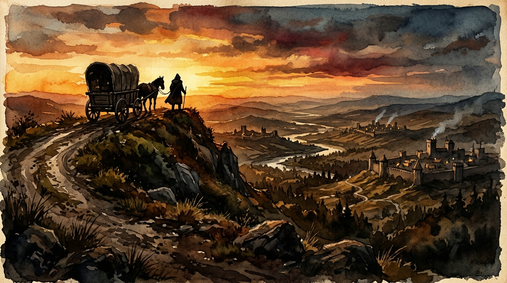

# ⚖️ The Merchant's Ledger

> *A Tale of Trade, Risk, and Fortune*

A fully client-side 2D menu-driven economic strategy game where you play as a traveling merchant navigating a dynamic supply-and-demand economy across 8 medieval towns. Buy low, sell high, survive the dangers of the road, and build a merchant empire — all from your browser.



---

## 🚀 Quick Start

```bash
# Install dependencies
npm install

# Start dev server
npm run dev

# Production build
npm run build

# Preview production build
npm run preview
```

Open **http://localhost:5173** in your browser. No backend needed — everything runs client-side.

---

## 🎮 How to Play

### The Goal
Start with nothing but a backpack, 200 gold, and a dream. Trade your way across the world, accumulate wealth, and purchase the **Merchant Estate in the Capital City for 100,000 Gold** to win.

### The Core Loop

```
🔍 Analyze  →  🛒 Trade  →  🗺️ Plan  →  🛤️ Travel  →  💰 Profit & Expand
```

1. **Analyze** — View the town's market to spot undervalued goods and high-demand imports
2. **Trade** — Buy goods using your gold and available cargo space
3. **Plan** — Open the World Map, check route distances, danger ratings, weather, and trade rumors
4. **Travel** — Watch the progress bar as your caravan moves. Consume daily food and wages while facing random road events
5. **Profit & Expand** — Arrive, sell at a premium, upgrade your vehicle, hire guards, learn skills, and repeat

### Game Over
You go **bankrupt** if you run out of gold, food, and cargo simultaneously while in a town.

---

## 🌍 The World

### 8 Towns Across 5 Biomes

| Town | Biome | Produces | Demands |
|------|-------|----------|---------|
| 🌾 **The Valley Farm** | Farmland | Wheat, Livestock, Food | Tools, Iron, Cloth |
| ⛏️ **The Mountain Forge** | Mountains | Iron, Tools, Weapons | Wheat, Cloth, Food |
| 🏜️ **The Desert Bazaar** | Desert | Spices, Silk, Cloth | Water, Tools, Livestock |
| 🌲 **The Deepwood Camp** | Forest | Timber, Furs | Weapons, Wheat, Iron |
| 🏰 **The Capital City** | Urban | Luxury Goods, Cloth | Spices, Furs, Iron, Wine, Books |
| ⚓ **The Port Harbor** | Coastal | Fish, Salt, Rope | Silk, Luxury Goods, Wood |
| ⛪ **The Monastery** | Highland | Wine, Herbs, Books | Wheat, Cloth, Salt |
| 🏴 **The Border Fort** | Frontier | Weapons, Iron | Food, Wheat, Herbs, everything else |

### 20 Tradeable Goods

Wheat, Livestock, Iron, Tools, Weapons, Spices, Silk, Water, Timber, Furs, Luxury Goods, Cloth, Food, Gold Coin, Salted Fish, Salt, Rope, Wine, Medicinal Herbs, Books

### 17 Trade Routes

Routes connect the 8 towns with varying distances (1–5 days) and danger ratings (8%–35%). Routes through mountains and frontiers are shorter but far more dangerous.

---

## 📊 Game Systems

### Dynamic Economy Engine

Every in-game day, each town **produces** and **consumes** goods based on its biome specialization:

- **Price Formula:** `Price = BasePrice × (BaseDemand / CurrentSupply)` — clamped between 25% and 400% of base price
- **Supply ticks daily** — production adds supply, consumption removes it
- **Prices shift organically** — buy a town's surplus cheap, haul it to where it's scarce, sell at a premium
- **Price History Sparklines** — SVG mini-charts in the market show price trends over the last 15 days

### 🌦️ Seasons (30-Day Cycle)

| Season | Effect |
|--------|--------|
| 🌸 **Spring** | +50% Wheat & Herb production, +150% Tool demand |
| ☀️ **Summer** | +50% Fish & Spice production, +150% Water demand |
| 🍂 **Autumn** | +80% Wheat, +60% Wine production, +50% Food demand |
| ❄️ **Winter** | −90% Wheat, −80% Food production. +200% Wood & Fur demand. Brutal. |

### 🌤️ Weather System

Weather changes every 5 days and varies by season. It affects route danger and travel time:

| Weather | Danger Mod | Speed Mod | Common In |
|---------|-----------|-----------|-----------|
| ☀️ Clear | +0% | +0 days | Summer |
| 🌧️ Rain | +5% | +0 days | Spring, Autumn |
| 🌫️ Fog | +12% | +0 days | Autumn |
| ⛈️ Storm | +15% | +1 day | Winter |

### 🌍 World Events

Random global events spawn every ~15 days and last 8–20 days, drastically affecting the economy:

| Event | Effect |
|-------|--------|
| 🎉 **Harvest Festival** | Spice/Wine/Luxury demand surges 2–2.5×. Danger drops. |
| ☠️ **Plague Outbreak** | Herb demand 3×. Food/Wheat production halved. Danger rises. |
| ⚔️ **Border Conflict** | Weapon/Iron demand 2.5–3×. Luxury production drops. Very dangerous routes. |
| 🥀 **Famine** | Wheat/Food demand 3–3.5×, production nearly stops. |
| 📈 **Trade Boom** | All production up 50%. Danger drops. Good times. |

### 🗡️ Road Events (8 Events)

During travel, random text-based encounters trigger based on route danger rating. Each event offers 2–4 choices with different risk/reward tradeoffs:

| Event | Type | Choices |
|-------|------|---------|
| 🗡️ **Bandit Ambush** | Danger | Pay toll (−100g), Flee (50/50), Fight (guard power vs 15) |
| 🐺 **Wolf Pack** | Danger | Light torches (−3 food), Fight, Throw food scraps (−5 food) |
| 👮 **Corrupt Guard** | Danger | Pay bribe (−75g), Argue (40% success), Intimidate (need 2+ guards) |
| ❄️ **Blizzard** | Danger | Make camp (−3 food), Push through (30% success, 70% lose 20% cargo) |
| 🔧 **Broken Wheel** | Neutral | Pay craftsman (−80g), Self-repair (60% success) |
| 🧑‍💼 **Stranded Traveler** | Fortune | Help (+80–150g), Ignore, Rob (+50–100g) |
| 💰 **Hidden Treasure** | Fortune | Force open (70% jackpot 100–300g, 30% trap −30g), Leave it |
| 🤝 **Wandering Merchant** | Fortune | Trade (net +20g value), Keep moving |

Events show an animated **outcome splash screen** with consequence breakdown (gold, food, cargo, guards) and screen shake on bad outcomes.

---

## 🚗 Progression

### Vehicle Tiers

Upgrade your transport at the **Wainwright** in any town:

| Tier | Vehicle | Cargo Slots | Food/Day | Max Guards | Cost |
|------|---------|-------------|----------|------------|------|
| 1 | 🎒 Traveler's Backpack | 5 | 1 | 0 | Free |
| 2 | 🛒 Pushcart | 15 | 1 | 1 | 500g |
| 3 | 🐴 Horse Wagon | 30 | 2 | 3 | 2,500g |
| 4 | 🏕️ Merchant Caravan | 60 | 4 | 8 | 10,000g |

### Guards

Hire guards at the **Tavern**. They protect cargo during dangerous events but cost daily wages:

| Tier | Name | Power | Daily Wage | Hire Cost |
|------|------|-------|------------|-----------|
| 1 | Sellsword | 5 + 0-2 | 5g/day | 25g (5-day advance) |
| 2 | Veteran | 12 + 0-2 | 12g/day | 60g (5-day advance) |

Guards desert if you can't feed them. They're released if you downgrade to a smaller vehicle.

### 📜 Contracts

Pick up delivery contracts at the **Tavern's Bulletin Board**:

- Accept up to **3 active contracts** at a time
- Each contract specifies: item, quantity, destination town, reward, and deadline
- Deliver the goods to the destination before the deadline to collect the reward
- Contracts expire if the deadline passes — choose carefully!

### ⭐ XP & Level System

Earn XP by buying and selling goods:
- **Buying:** XP = total cost ÷ 10
- **Selling:** XP = total earned ÷ 5

Levels unlock **skills/perks** in the **Ledger** screen.

### 🧠 Skills (7 Perks)

Learn skills from the **📊 Ledger** screen when you reach the required level:

| Skill | Level | Effect |
|-------|-------|--------|
| 🗣️ **Haggler** | 2 | All buy prices reduced by 8% |
| 🍖 **Iron Stomach** | 3 | Daily food consumption reduced by 1 |
| 🧭 **Pathfinder** | 4 | All routes take 1 fewer day (min 1) |
| 💬 **Silver Tongue** | 5 | Reputation gains doubled |
| 📦 **Bulk Trader** | 6 | +5 cargo slots on every vehicle |
| 👁️ **Scout's Eye** | 7 | Route danger reduced by 10% |
| 👑 **Merchant Lord** | 8 | Contract rewards increased by 25% |

### 🤝 Reputation

Selling goods profitably at a town builds your reputation there (max ±100):

- **Positive reputation** → price discounts (up to 10% off at +100 rep)
- **Negative reputation** → price markups
- Silver Tongue skill doubles reputation gains

---

## 🖥️ Screens & UI

### Title Screen
Start a new game or continue from your auto-saved progress. Shows gameplay tips.

### Town Screen (Main Hub)
- **Left Panel — Town Market:** Browse available goods with stock, price, trend sparkline, and buy controls
- **Right Panel — Your Cargo:** View inventory with purchase price, sell price, and profit/loss per item
- **Footer Navigation:** Tavern (guards & contracts), Wainwright (vehicle upgrades), Ledger (stats & skills), Map (travel)
- **Victory Button:** Appears in the Capital City when you have 100,000g+

### Map Screen
- Parchment-style world map with town nodes and dotted route lines
- **Hover** a town to see distance, danger, weather, and trade rumors
- **Click** a town to select it, then see a detailed travel sidebar with food/gold cost estimates
- **World event badges** displayed at the top when active

### Travel Screen
- Animated progress bar with your vehicle emoji moving along the road
- Real-time status cards showing day, gold, food, guards, power, and cargo
- Auto-ticks at 1.2 seconds per in-game day
- Pauses for random events

### Event Screen (Overlay)
- Two-phase flow: **choosing** (read description, pick from 2–4 choices) → **outcome** (animated splash with consequences)
- Screen shake on bad outcomes, gold burst animation on jackpots
- Full consequence breakdown: gold, food, cargo, and guard changes

### Tavern Screen
- **Hire Guards** — browse available mercenaries, see their power and daily wage
- **Fire Guards** — release guards you can't afford
- **Bulletin Board** — accept delivery contracts for bonus gold
- **Active Contracts** — track progress on accepted contracts

### Wainwright Screen
- Compare all 4 vehicle tiers side-by-side
- See upgrade costs and stat improvements vs. your current vehicle
- Sequential upgrade only (can't skip tiers)

### Ledger Screen (Stats & Skills)
- **Trade Statistics** — days, profit, gold earned/spent, trades, cargo lost, events faced, contracts completed
- **Reputation** — progress bars for each town showing your standing
- **World Events** — current active global events with descriptions and timers
- **Level & XP** — XP bar with progress to next level
- **Skills** — learn available perks when you reach the required level

### HUD (Always Visible)
Persistent top bar showing: Gold, Food, Vehicle, Cargo (slots used/max), Guards, Level, Season, and Day.

### Message Log (Always Visible)
Bottom ticker showing the last 5 game messages. Color-coded toast notifications pop up for important events.

---

## 💾 Auto-Save

The game **auto-saves to localStorage** on every state change. Features:

- **Continue** from the title screen to resume your last session
- **New Game** clears the save and starts fresh
- Old saves are automatically migrated when new features are added
- Mid-travel saves safely return you to your origin town on reload
- Saving is skipped on title/game-over/victory screens

---

## 🏗️ Tech Stack

| Technology | Purpose |
|-----------|---------|
| **React 18** | UI rendering and component architecture |
| **TypeScript** | Type-safe game state and engine logic |
| **Vite 6** | Dev server with HMR and production bundler |
| **CSS3** | Dark fantasy parchment theme with custom animations |
| **localStorage** | Client-side auto-save persistence |
| **AI-Generated Art** | 20 dark fantasy watercolor images for towns, events, and UI |

### Architecture

The game uses an **immutable state machine** pattern:
- **`gameEngine.ts`** — Pure functions that take state and return new state (no side effects)
- **`GameContext.tsx`** — React reducer that dispatches actions to the engine
- **Screens** — React components that read state and dispatch actions

```
User Input → React Dispatch → Reducer → Engine (pure) → New State → Re-render
                                                              ↓
                                                      localStorage Save
```

---

## 📁 Project Structure

```
merchants-ledger/
├── public/
│   └── images/
│       ├── towns/          # 9 town background images (8 towns + tavern interior)
│       ├── events/         # 8 road event portrait images
│       └── ui/             # 3 UI images (title, map, game over)
├── src/
│   ├── types/
│   │   └── game.ts         # All TypeScript interfaces and type definitions
│   ├── data/
│   │   ├── items.ts        # 20 tradeable goods with base prices and demand
│   │   ├── towns.ts        # 8 towns with production/consumption rates
│   │   ├── routes.ts       # 17 routes with distances and danger ratings
│   │   ├── vehicles.ts     # 4 vehicle tiers, guard tiers, game constants
│   │   ├── events.ts       # 8 random road events with choice resolution logic
│   │   └── images.ts       # Town background image mapping
│   ├── engine/
│   │   └── gameEngine.ts   # Pure state machine: economy, trading, travel, combat,
│   │                       # weather, world events, contracts, skills, reputation
│   ├── context/
│   │   └── GameContext.tsx  # React reducer, localStorage save/load, action dispatch
│   ├── components/
│   │   ├── HUD.tsx         # Persistent top status bar
│   │   ├── MessageLog.tsx  # Bottom message ticker
│   │   ├── Sparkline.tsx   # SVG price history mini-charts
│   │   └── Toasts.tsx      # Notification toast system with auto-watch
│   ├── screens/
│   │   ├── TitleScreen.tsx
│   │   ├── TownScreen.tsx         # Market + inventory + food purchase
│   │   ├── MapScreen.tsx          # World map with routes, tooltips, travel sidebar
│   │   ├── TravelScreen.tsx       # Animated travel progress
│   │   ├── EventScreen.tsx        # Two-phase event resolution with outcome splash
│   │   ├── TavernScreen.tsx       # Guard hiring + contracts bulletin board
│   │   ├── WainwrightScreen.tsx   # Vehicle upgrade shop
│   │   ├── StatsScreen.tsx        # Statistics, reputation, world events, skills
│   │   └── GameOverVictoryScreens.tsx
│   ├── styles/
│   │   └── global.css      # Dark fantasy parchment theme + animations
│   ├── App.tsx              # Root router + toast container
│   └── main.tsx             # React entry point
├── index.html
├── package.json
├── tsconfig.json
├── vite.config.ts
├── game_mechanics_guide.md  # Original game design document
└── .gitignore
```

---

## 🎨 Art Style

All 20 images use a consistent **dark fantasy watercolor concept art** style with painterly brushstrokes, atmospheric lighting, and muted earth tones with rich accent colors. The UI theme matches with a dark parchment color palette, gold accents, and serif display fonts.

---

## 📜 License

MIT
